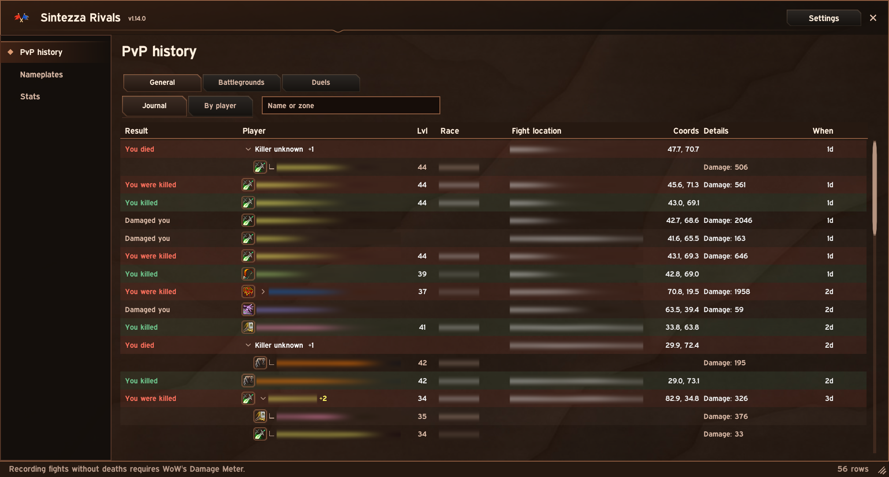
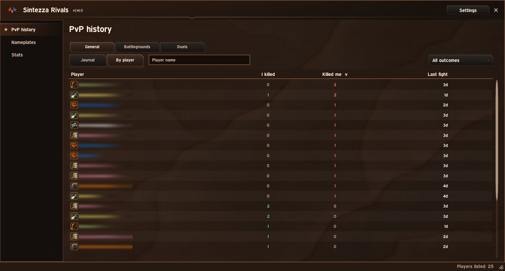
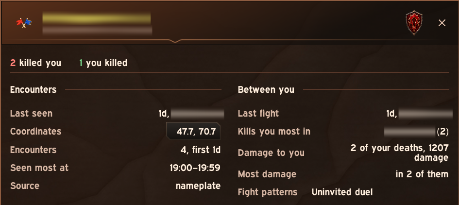
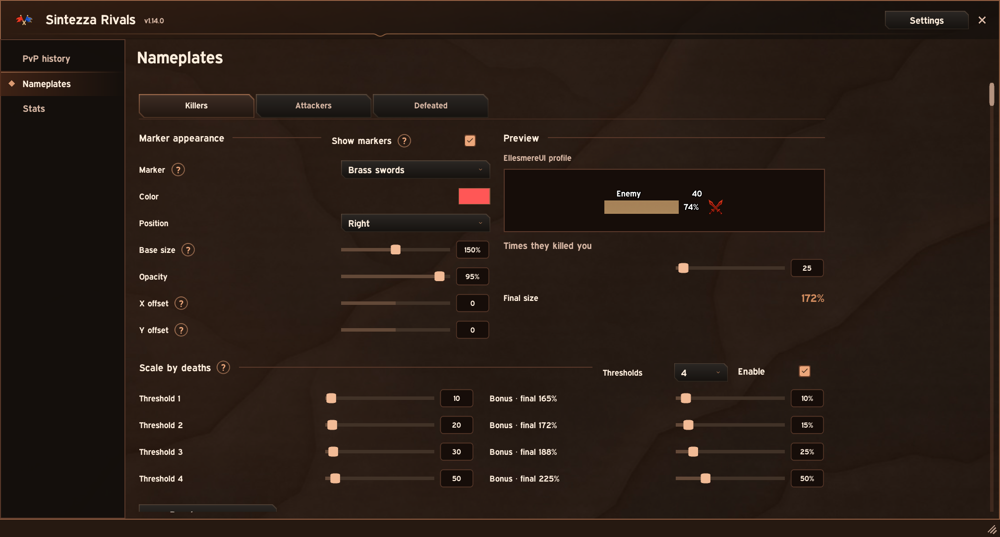
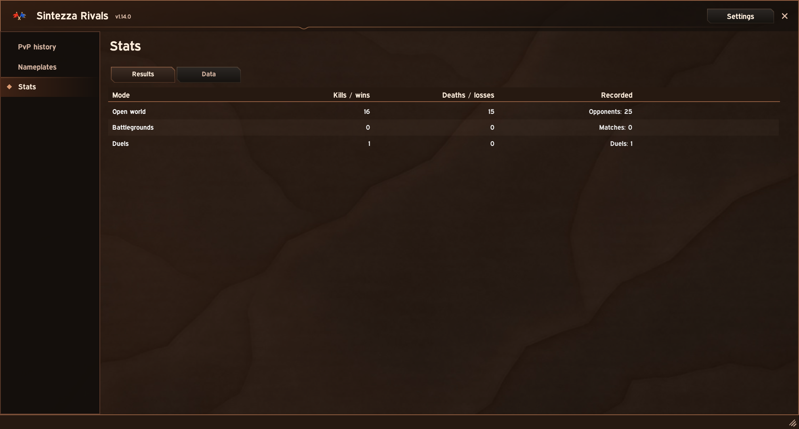

# Sintezza Rivals

| CurseForge field | Value |
| --- | --- |
| Game | World of Warcraft |
| Class | Addons |
| Flavor and version | Forever 1.60.1 |
| Main category | PvP |
| Additional categories | Battleground, Map & Minimap, Data Export |
| CurseForge relations | Sintezza Theme (Required Dependency) |
| Project license | MIT. See the repository for third-party notices. |

## Summary

World PvP fight history, battleground and duel results, and enemy nameplate markers for WoW Forever.

## Description

Sintezza Rivals keeps a personal PvP journal in WoW Forever. Open `/rivals history` to look up a fight, check how often you faced an opponent, or review your battleground and duel results.

### Read a world PvP fight

Expand a fight to see the recorded opponents and available damage. The journal distinguishes confirmed kills, deaths, and damage-only encounters.

Filter by name or zone. When the client reports readable damage, you can expand a fight to see more of what happened. Recording encounters without a death requires WoW's Damage Meter.

### Find a past opponent

Switch to By player to compare your record against each opponent and find your last fight.

Open an opponent card for their encounter history, last known position, and the damage recorded between you.

Select a player to see their card. Use **Watch** for sighting alerts or **Ignore** to hide that player's markers and mute those alerts. Rivals keeps your recorded history in either case.

### Mark players you have fought

Preview an icon for players who killed you and set the death counts at which it grows.

Open `/rivals marks` to preview the icon, position, color, and size. Set up **Killers**, **Attackers**, and **Defeated** separately. Icons can grow as your recorded deaths, damage episodes, or confirmed kills reach the thresholds you choose. Toggle world-fight markers to revisit their locations on the map.

### Check results and export history

Review separate totals for open-world PvP, battleground matches, and duels.

Battleground history is organized by match. You can review duels individually or group them by opponent or class. Rivals stores history per character. Use **Stats → Data** to import or export selected sections as CSV.

### Appearance

**Requires [Sintezza Theme](https://github.com/ArtefactoO/Sintezza_Theme).** Open `/stheme` to choose the palette, button styles, background, fonts, and interface language.

### Optional integrations

Rivals supports [EllesmereUI Nameplates](https://www.curseforge.com/wow/addons/ellesmereui) and the Blizzard map or [OpenMap](https://www.curseforge.com/wow/addons/openmap). [TomTom](https://www.curseforge.com/wow/addons/tomtom) can set a waypoint, and [Sintezza UI](https://github.com/ArtefactoO/Sintezza_UI) can dock the fight-marker toggle next to its party map controls.

<!-- Changelog field -->

### Changelog

[View the release history on GitHub](https://github.com/ArtefactoO/Sintezza_Rivals/blob/main/CHANGELOG.md).

Source, installation details, and credits are available on [GitHub](https://github.com/ArtefactoO/Sintezza_Rivals).
