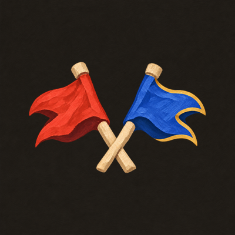
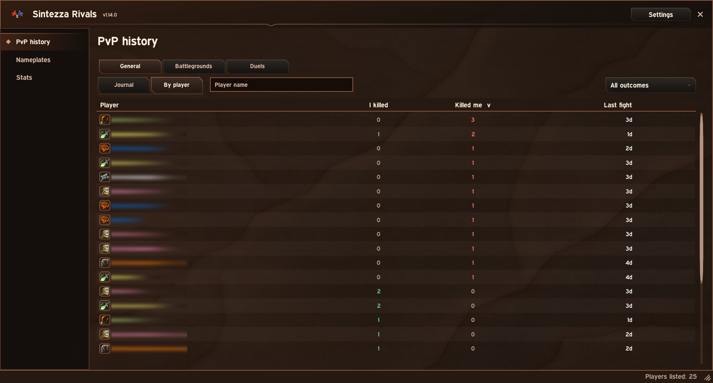
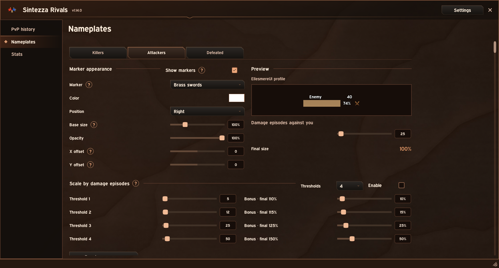
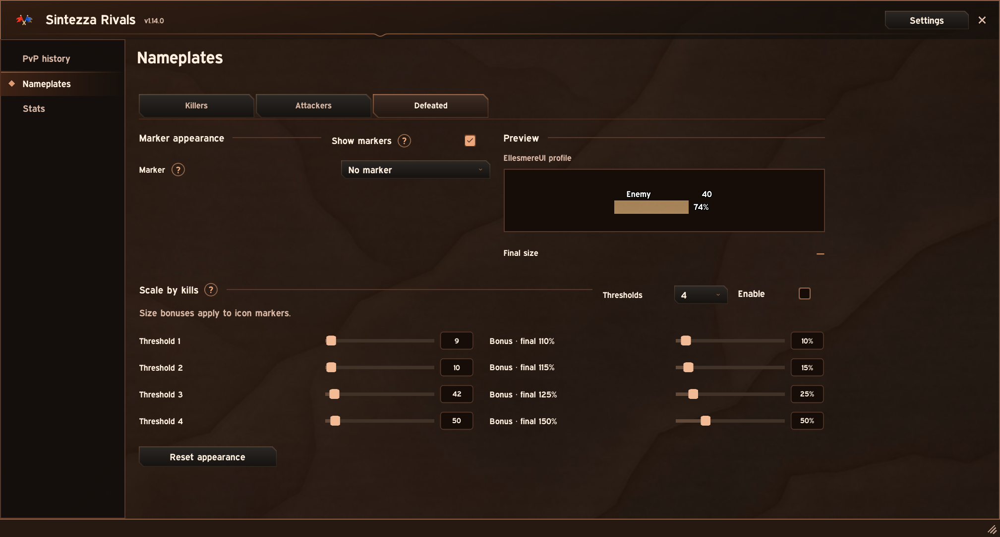
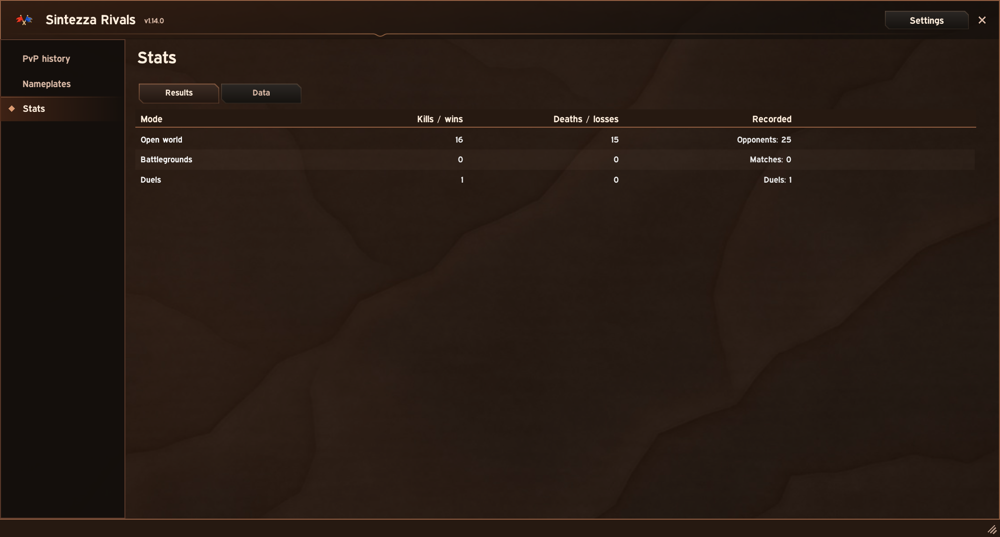

# Sintezza Rivals

Sintezza Rivals records world PvP, battleground matches, and duels in World of Warcraft Forever 1.60.1. Review fights, find past opponents, and mark players on enemy nameplates and the world map.

Install and enable **[Sintezza Theme](https://github.com/ArtefactoO/Sintezza_Theme)** alongside Rivals. It supplies the shared windows, controls, and language settings. **EllesmereUI Nameplates**, **Sintezza UI**, and **TomTom** are optional. The interface is available in English and Russian. Change the language in `/stheme` and reload the UI.

## What you can track

- **World PvP.** Search the fight journal or switch to the player summary for your confirmed kills, deaths, and last encounter with each opponent. Expand a grouped fight to see its earlier episodes and available damage details.
- **Battlegrounds and duels.** Browse battlegrounds by match. View individual duels or compare results by opponent or class. Rivals matches opponents by full name and fills missing card details from saved sightings or when you target that character again.
- **Map and nameplates.** Toggle world-PvP fight markers on the Blizzard map or OpenMap. Configure nameplate icons, outlines, and name colors by category, with a preview. Add enemies to your watchlist to receive chat, on-screen, or sound alerts.
- **Data.** Open Statistics → Data to review record counts, import or export individual sections as CSV, measure memory use, and clear a section with confirmation. Rivals stores history and settings locally per character.

Rivals keeps up to 1,000 recent opponent observations for profile details and alerts. Combat entries store their participants separately. When the client exposes a readable damage-meter snapshot, the history keeps its full fight participants and damage after a death as well as after a survived fight. The confirmed finishing blow comes from the death recap. Damage totals from these two sources are kept separately.

Fight details depend on what the client exposes. Rivals counts killing blows from confirmed combat events. Nonlethal world fights require a player source in the built-in WoW damage meter's Damage Taken view. The general history retains older entries with unknown battleground boundaries.

## Player cards and settings

Click a player name to open a compact card with all available fields in two columns. World PvP cards include your score, encounters, the busiest recorded sighting hour, damage and fight-pattern descriptions. Duel cards show results and separate average/longest durations. Battleground opponent cards show the selected match only. Hover a field for its source or calculation; Copy includes the full card.

Fight-pattern descriptions are playful labels derived from your saved deaths. Each pattern has several wordings, selected consistently for each opponent. Their tooltips explain the qualifying events. Sighting hours describe your recorded encounters in client-local time, not a player's online schedule.

**Watch** enables the configured encounter alerts. **Ignore** hides the player's nameplate marker, suppresses encounter alerts, and removes them from the encounter strip. History and new records are retained. Click **Stop ignoring** to restore normal behavior. Rivals' ignore list is separate from WoW's chat ignore list. Separate marker-only hiding is no longer used.

Open **Settings** at the right of the main window header. Settings use the same shared Theme controls as the other Sintezza addons. The Recording and alerts page includes all detection and alert parameters directly; longer pages scroll. Colors, fonts, textures, and language remain in Sintezza Theme. Rivals' own tooltips use the shared Theme tooltip beside the cursor. The copy window follows the addon's window preferences; banners use the shared fonts.

Alert sounds are used for watched-player sightings and observed nearby stealth, subject to the enabled sources, cooldown, level filter and ignore rules. They do not announce every fight. Use **Sound preview → Play** to test the client sound independently of recording and the automatic sound switch. Game audio settings still apply. Settings group recording, observation sources, alerts and chat separately; map settings separate sightings, fights and minimap blips. Dependent controls retain their saved values while inactive.

Race and location names are captured from the game client's localized data and retained in history. Changing the Theme language changes interface captions and token-based class names; it does not translate previously recorded race or location strings. Older records without a localized race name may use a race-token fallback.

Nameplate settings use compact, unfilled Theme sections and a separate live preview. The columns stack when space is limited. Killers, attackers, and defeated players each have threshold/bonus slider pairs below the preview and appearance controls. Killer thresholds count your deaths, attacker thresholds count saved damage episodes, and defeated-player thresholds count your confirmed killing blows. Recap and full-meter records with the same combat identifier count once for attackers. Thresholds can be configured before choosing an icon, but size bonuses apply only to icon markers. The manual category and Mark target button are temporarily hidden; saved manual-marker settings remain intact. Brass swords use a Rivals-local texture restored from the original artwork; addon logos keep their shared Theme icon.

Linked edits adjust only neighbors that would violate ordering. Thresholds remain strictly increasing; bonuses remain equal or increasing, so marker size does not shrink at higher counts. Old decreasing bonus configurations normalize upward when loaded. Slider axes stay fixed during edits; precise values can be typed in their value boxes.

## Commands

| Command | Opens |
| --- | --- |
| `/rivals` | Main window |
| `/rivals history` | Open PvP history |
| `/rivals marks` | Nameplate settings and preview |
| `/rivals csv` | Import and export |
| `/rivals test` / `/rivals test stop` | Start or stop an unsaved PvP preview |

## Gallery

Expand a fight to see the recorded opponents and available damage. The journal distinguishes confirmed kills, deaths, and damage-only encounters.

Switch to By player to compare your record against each opponent and find your last fight.

Open an opponent card for their encounter history, last known position, and the damage recorded between you.

Preview an icon for players who killed you and set the death counts at which it grows.

Attackers have their own marker options and can scale by recorded damage episodes.

Set separate thresholds for opponents you defeated. Size bonuses take effect when you select an icon marker.

Review separate totals for open-world PvP, battleground matches, and duels.

## License and credits

Inspired by [OpenPvPForever](https://www.curseforge.com/wow/addons/openpvpforever) by pvpninja and contributors. [MIT License and code credits](LICENSE) · [Changelog](CHANGELOG.md)

[CurseForge listing fields](CURSEFORGE.md)
