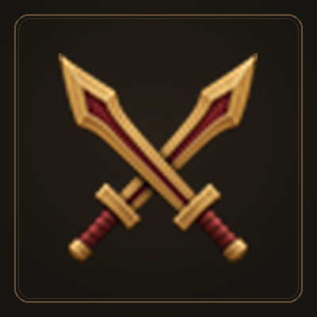
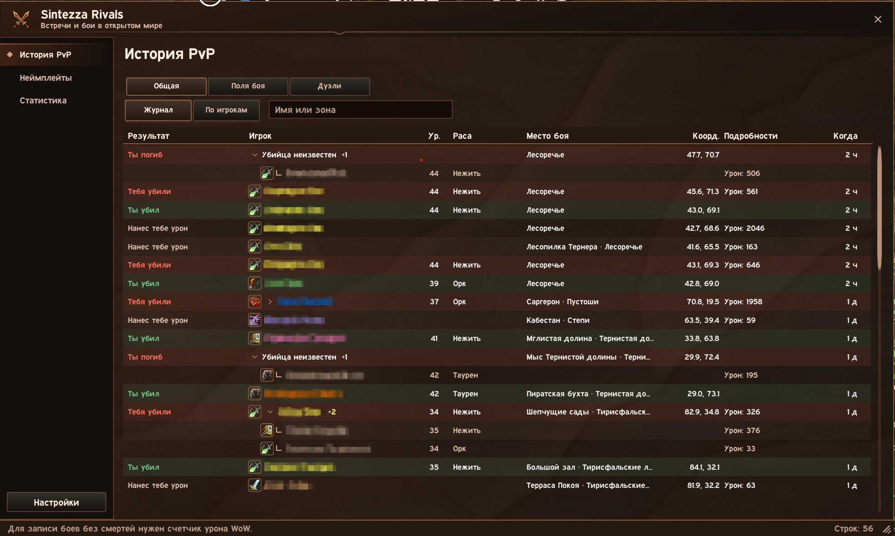
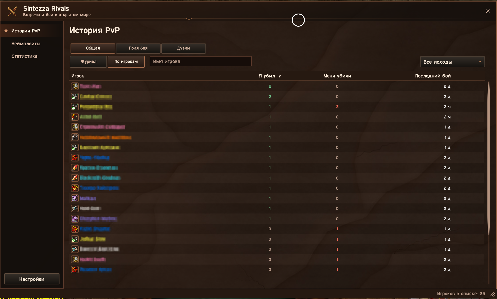
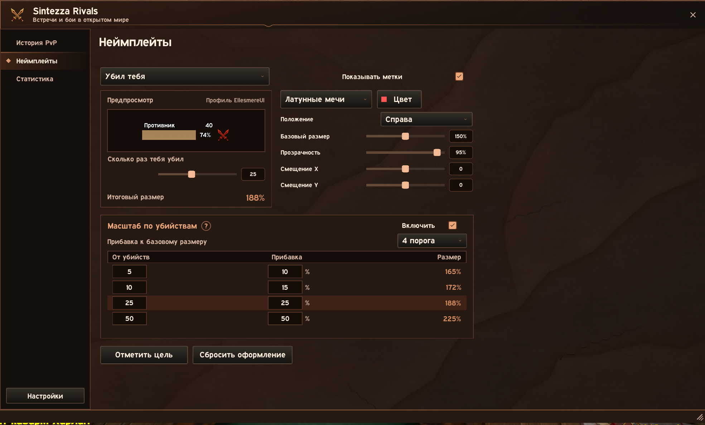

# Sintezza Rivals

Sintezza Rivals records world PvP, battleground matches, and duels in World of Warcraft Forever 1.60.1. Review fights, find past opponents, and mark players on enemy nameplates and the world map.

Install and enable **[Sintezza Theme](https://github.com/ArtefactoO/Sintezza_Theme)** alongside Rivals. It supplies the shared windows, controls, and language settings. **EllesmereUI Nameplates**, **Sintezza UI**, and **TomTom** are optional. The interface is available in English and Russian. Change the language in `/stheme` and reload the UI.

## What you can track

- **World PvP.** Search the fight journal or switch to the player summary for your confirmed kills, deaths, and last encounter with each opponent. Expand a grouped fight to see its earlier episodes and available damage details.
- **Battlegrounds and duels.** Browse battlegrounds by match. View individual duels or compare results by opponent or class. Rivals matches opponents by full name and fills missing card details from saved sightings or when you target that character again.
- **Map and nameplates.** Toggle world-PvP fight markers on the Blizzard map or OpenMap. Configure nameplate icons, outlines, and name colors by category, with a preview. Add enemies to your watchlist to receive chat, on-screen, or sound alerts.
- **Data.** Open Statistics → Data to review record counts, import or export individual sections as CSV, measure memory use, and clear a section with confirmation. Rivals stores history and settings locally per character.

Fight details depend on what the client exposes. Rivals counts killing blows from confirmed combat events. Nonlethal world fights require a player source in the built-in WoW damage meter's Damage Taken view. The general history retains older entries with unknown battleground boundaries.

## Commands

| Command | Opens |
| --- | --- |
| `/rivals` | Main window |
| `/rivals history` | PvP history. Right-click the minimap swords for the same window |
| `/rivals marks` | Nameplate settings and preview |
| `/rivals csv` | Import and export |
| `/rivals test` / `/rivals test stop` | Start or stop an unsaved PvP preview |

## Gallery

## License and credits

Sintezza Rivals is distributed under the MIT license. The world PvP journal incorporates adapted code from OpenPvPForever 1.1.0 by pvpninja and contributors. Sintezza adds the separate battleground and duel histories, map markers, and customizable nameplate marks. [MIT license](LICENSE) · [OpenPvPForever 1.1.0](https://www.curseforge.com/wow/addons/openpvpforever/files/9286961) · [Changelog](CHANGELOG.md)

## На русском

Sintezza Rivals ведет журнал боев в открытом мире, на полях боя и в дуэлях в WoW Forever 1.60.1. Для работы включи **Sintezza Theme**. Язык выбирается в `/stheme` и применяется после перезагрузки интерфейса.

- **Открытый мир.** В «Истории PvP» можно переключаться между журналом боев и сводкой по игрокам. Сводка показывает подтвержденные добивания, смерти и время последней встречи. Предыдущие эпизоды боя раскрываются внутри записи.
- **Поля боя и дуэли.** У каждого поля боя своя запись с доступным итогом и эпизодами. Дуэли можно смотреть по отдельности, по соперникам и по классам. Rivals различает соперников по имени и фамилии и заполняет пропуски в карточке по истории встреч или при повторном выборе этого персонажа в цель.
- **Карта и неймплейты.** Кнопка с мечами переключает точки боев в стандартной карте и OpenMap. В настройках неймплейтов можно выбрать значок, окантовку или цвет имени для каждой категории и оценить вид в предпросмотре. Для списка наблюдения доступны оповещения в чате, на экране или звуком.
- **Данные.** В разделе «Статистика → Данные» доступны счетчики записей, импорт и экспорт CSV, замер памяти и очистка разделов с подтверждением. История хранится локально для каждого персонажа.

`/rivals` открывает главное окно, `/rivals history` — журнал, `/rivals marks` — настройки меток, `/rivals csv` — обмен данными. Команды `/rivals test` и `/rivals test stop` включают и выключают несохраняемый тест.

Подробности зависят от данных клиента. Несмертельные бои в открытом мире записываются, если встроенный счетчик урона показывает игрока среди источников полученного урона. Добивания учитываются по подтвержденным событиям. Журнал использует адаптированный код OpenPvPForever. [Лицензия MIT](LICENSE) · [История изменений](CHANGELOG.md)

[CurseForge listing fields](CURSEFORGE.md)
